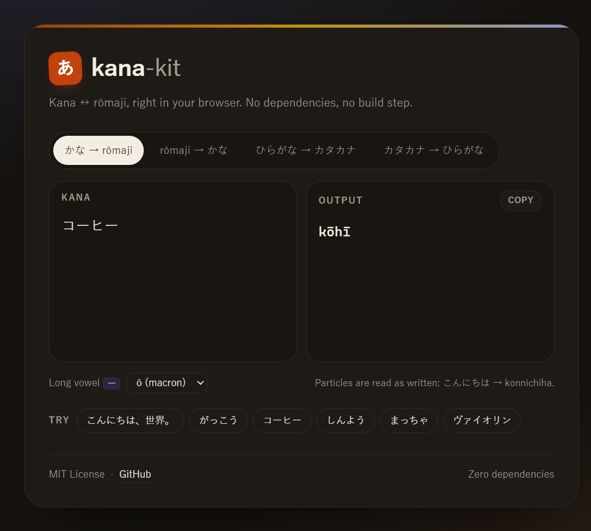

# kana-kit

**Kana ↔ rōmaji for JavaScript, with zero dependencies.**

kana-kit converts between hiragana, katakana, and Hepburn-style rōmaji in
Node.js or the browser. It ships as a small ES module, a CLI, and a playground
— no build step, no runtime dependencies.

[](https://github.com/chopenguin/kana-kit/actions/workflows/ci.yml)
[](LICENSE)
[](package.json)

**[Try the live demo →](https://chopenguin.github.io/kana-kit/demo/)**



## Features

- Hiragana ⇄ katakana, including half-width katakana input (`ｺﾞﾊﾝ` → `ごはん`)
- Kana → Hepburn rōmaji (`しんよう` → `shin'you`, `まっちゃ` → `matcha`)
- Rōmaji → kana (`konnichiwa` → `こんにちわ`, `gakkou` → `がっこう`)
- Small tsu (っ), syllabic n (ん), long vowel marks (ー), and common loanword
  combinations such as `ファ`, `ティ`, `ウィ`, and `ジェ`
- Zero dependencies, no build step, works with any modern browser or Node.js 20+
- CLI and interactive demo included

## Install

kana-kit is not on npm yet. Install it straight from GitHub:

```sh
npm install github:chopenguin/kana-kit
```

## Usage

```js
import { fromRomaji, toHiragana, toKatakana, toRomaji } from "kana-kit";

toKatakana("ひらがな"); // "ヒラガナ"
toHiragana("カタカナ"); // "かたかな"
toHiragana("ｺﾞﾊﾝ"); // "ごはん"

toRomaji("こんにちは"); // "konnichiha"
toRomaji("がっこう"); // "gakkou"
toRomaji("コーヒー"); // "kōhī"
toRomaji("しんよう"); // "shin'you"

fromRomaji("konnichiwa"); // "こんにちわ"
fromRomaji("matcha"); // "まっちゃ"
fromRomaji("shin'you"); // "しんよう"
```

### `toRomaji(text, options?)`

| Option      | Type                                | Default    | Description                                                   |
| ----------- | ----------------------------------- | ---------- | ------------------------------------------------------------- |
| `longVowel` | `"macron" \| "double" \| "ignore"`  | `"macron"` | How to write `ー`: `kōhī`, `koohii`, or `kohi`.               |
| `wo`        | `"o" \| "wo"`                       | `"o"`      | Whether `を` becomes `o` (Hepburn) or `wo` (train-station style). |

```js
toRomaji("コーヒー", { longVowel: "double" }); // "koohii"
toRomaji("コーヒー", { longVowel: "ignore" }); // "kohi"
toRomaji("を"); // "o"
toRomaji("を", { wo: "wo" }); // "wo"
```

### `fromRomaji(text)`

Converts rōmaji to hiragana. Matching is greedy and case-insensitive:

- doubled consonants become っ (`kitte` → `きって`, `matcha` → `まっちゃ`)
- `n` before a consonant or at the end becomes ん (`senpai` → `せんぱい`)
- `n'` is an explicit syllabic n (`kan'i` → `かんい`)
- Kunrei-style spellings are accepted (`si` → `し`, `tu` → `つ`, `zya` → `じゃ`)

### `toHiragana(text)` / `toKatakana(text)`

Script conversion only. Kanji, Latin letters, punctuation, and emoji pass
through untouched. Half-width katakana runs are normalized to full-width first.

### `normalizeWidth(text)`

Normalizes half-width katakana runs (`ﾊﾝｶｸ` → `ハンカク`) without touching the
rest of the string. The other converters call this for you.

## Browser

```html
<script type="module">
  import { toRomaji } from "./src/index.js";

  console.log(toRomaji("こんにちは")); // "konnichiha"
</script>
```

The module uses only standard JavaScript — no bundler required.

## CLI

```sh
node bin/kana.js romaji "こんにちは"
# konnichiha

node bin/kana.js kana "matcha"
# まっちゃ

echo "カタカナ" | node bin/kana.js hiragana
# かたかな
```

```
Usage:
  kana <mode> [text...]
  echo "text" | kana <mode>

Modes:
  hiragana   katakana → hiragana
  katakana   hiragana → katakana
  romaji     kana → rōmaji
  kana       rōmaji → kana

Options:
  --long-vowel <style>   macron (default), double, or ignore
  --wo                   write を as "wo" instead of "o"
  -h, --help             show this help
```

## Demo

The playground lives in [`demo/`](demo/) and is deployed to GitHub Pages:

**https://chopenguin.github.io/kana-kit/demo/**

To run it locally, serve the repository root with any static file server:

```sh
python -m http.server 8000
# or
npx serve .
```

Then open `http://localhost:8000/demo/`.

## Notes and limitations

- **Phonetic, not orthographic.** kana-kit does not know grammar or vocabulary.
  Particles are read as written (`は` → `ha`), so `こんにちは` becomes
  `konnichiha`, and `konnichiwa` comes back as `こんにちわ`.
- **No kanji reading.** Kanji and other non-kana characters are preserved.
- **`ー` is the only long-vowel source.** `おう` is kept as `ou`, because
  contracting it needs word-level knowledge: `がっこう` would be `gakkou`, but
  `おもう` should stay `omou`.
- **Ambiguous rōmaji uses common conventions.** `ji` → `じ`, `zu` → `ず`,
  `wo` → `を`, `ti` → `ち`, `di` → `ぢ`, `si` → `し`.
- **This is not a morphological analyzer.** For readings of kanji, use a
  dictionary or a tokenizer.

## Development

There is nothing to install; tests use Node's built-in test runner.

```sh
npm test
```

The test suite covers script conversion, rōmaji conversion, round trips, and the
CLI. Contributions are welcome — see [CONTRIBUTING.md](CONTRIBUTING.md).

## License

[MIT](LICENSE) © chopenguin
