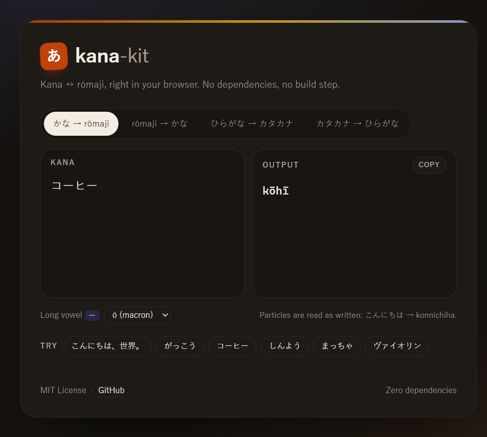

# kana-kit

**零依賴的日文假名 ↔ 羅馬字轉換工具。**

[English](README.md) | 繁體中文

kana-kit 可以在平假名、片假名與 Hepburn 式羅馬字之間互相轉換，支援
Node.js 與瀏覽器。它是一個小型 ES module，附帶 CLI 與網頁 playground，
不需要建置流程，也沒有任何執行期依賴。

[](https://github.com/chopenguin/kana-kit/actions/workflows/ci.yml)
[](LICENSE)

**[線上 Demo →](https://chopenguin.github.io/kana-kit/demo/)**



## 安裝

kana-kit 目前還沒發佈到 npm，可直接從 GitHub 安裝：

```sh
npm install github:chopenguin/kana-kit
```

## 使用範例

```js
import { fromRomaji, toHiragana, toKatakana, toRomaji } from "kana-kit";

toKatakana("ひらがな"); // "ヒラガナ"
toHiragana("カタカナ"); // "かたかな"
toHiragana("ｺﾞﾊﾝ"); // "ごはん"

toRomaji("こんにちは"); // "konnichiha"
toRomaji("コーヒー"); // "kōhī"
toRomaji("しんよう"); // "shin'you"

fromRomaji("konnichiwa"); // "こんにちわ"
fromRomaji("matcha"); // "まっちゃ"
```

`toRomaji` 可調整長音與 `を` 的寫法：

```js
toRomaji("コーヒー", { longVowel: "double" }); // "koohii"
toRomaji("コーヒー", { longVowel: "ignore" }); // "kohi"
toRomaji("を", { wo: "wo" }); // "wo"
```

## CLI

```sh
node bin/kana.js romaji "こんにちは"
# konnichiha

node bin/kana.js kana "matcha"
# まっちゃ

echo "カタカナ" | node bin/kana.js hiragana
# かたかな
```

模式有 `hiragana`、`katakana`、`romaji`、`kana`，完整說明請見
[英文 README](README.md#cli)。

## 特性

- 平假名 ⇄ 片假名，包含半角片假名（`ｺﾞﾊﾝ` → `ごはん`）
- 假名 → Hepburn 羅馬字，支援促音、撥音、長音與外來語組合（`ファ`、`ティ`、`ウィ`）
- 羅馬字 → 假名，支援促音、`n'` 與 Kunrei 拼法
- 零依賴、免建置，Node.js 20+ 與現代瀏覽器皆可使用

## 限制

- 轉換是**表音**的，不處理文法：助詞 `は` 會轉成 `ha`，`こんにちは` →
  `konnichiha`，反向則是 `こんにちわ`。
- 不轉換漢字，非假名字元會原樣保留。
- 只有 `ー` 會展開成長音；`おう` 會保留為 `ou`，因為是否需要縮寫得看單字。

## 開發

```sh
npm test
```

測試使用 Node.js 內建的 test runner，不需要安裝任何套件。

## 授權

[MIT](LICENSE) © chopenguin
